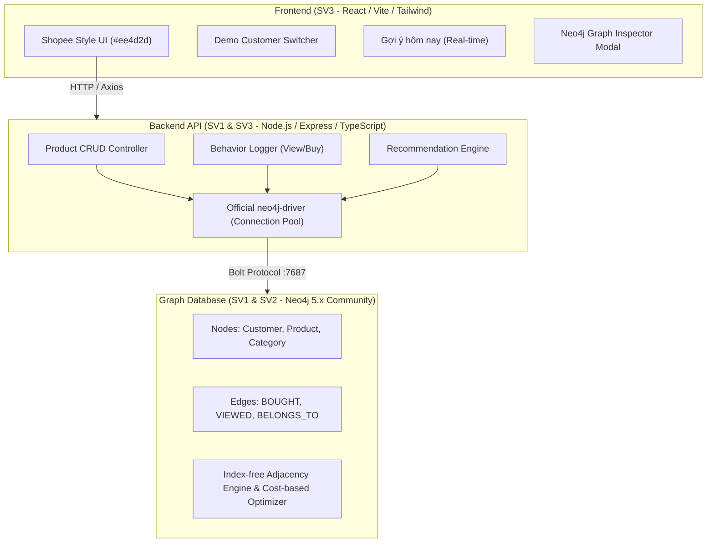
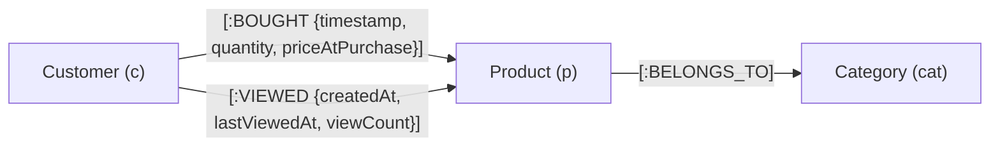

# BÁO CÁO KIẾN TRÚC KỸ THUẬT HỆ THỐNG GỢI Ý (NEO4J RECOMMENDATION SYSTEM)
**Đề tài:** Hệ Thống Gợi Ý Sản Phẩm Tương Quan Bằng Graph Database (Neo4j)  
**Nhóm sinh viên thực hiện:** 3 Sinh viên (SV1 - SV2 - SV3)

---

## 1. TỔNG QUAN KIẾN TRÚC HỆ THỐNG

Hệ thống được thiết kế theo mô hình **3-Tier Architecture** hiện đại, phân tách rõ ràng giữa tầng hiển thị (Frontend), tầng xử lý nghiệp vụ (Backend API) và tầng lưu trữ đồ thị (Graph Database Engine):



---

## 2. MÔ HÌNH HÓA DỮ LIỆU ĐỒ THỊ (GRAPH DATA MODEL)

### 2.1. Node Labels và Thuộc tính (SV1)

| Node Label | Thuộc tính chính | Kiểu dữ liệu | Ý nghĩa |
| :--- | :--- | :--- | :--- |
| **`:Customer`** | `id` | String (Unique) | Mã định danh khách hàng (ví dụ: `CUST-001`) |
| | `name` | String | Họ và tên khách hàng |
| | `email` | String | Địa chỉ thư điện tử |
| | `avatar` | String (URL) | Ảnh đại diện |
| **`:Product`** | `id` | String (Unique) | Mã sản phẩm (ví dụ: `PROD-TECH-001`) |
| | `name` | String | Tên đầy đủ sản phẩm |
| | `price` | Float | Giá bán khuyến mãi (VNĐ) |
| | `originalPrice` | Float | Giá niêm yết gốc (VNĐ) |
| | `discountPercent`| Integer | % Giảm giá hiển thị trên tag Shopee |
| | `rating` | Float | Đánh giá sao trung bình (1.0 - 5.0) |
| | `soldCount` | Integer | Số lượng đã bán lũy kế |
| | `imageUrl` | String (URL) | Đường dẫn ảnh chất lượng cao |
| **`:Category`** | `id` | String (Unique) | Mã danh mục (`CAT-TECH`, `CAT-BEAUTY`...) |
| | `name` | String | Tên tiếng Việt ngành hàng |
| | `icon` | String | Icon biểu tượng (Emoji / SVG) |

### 2.2. Relationship Types (Quan hệ) và Thuộc tính trên Cạnh



---

## 3. THUẬT TOÁN COLLABORATIVE FILTERING BẰNG CYPHER (SV2)

### 3.1. Nguyên lý duyệt đồ thị (Graph Traversal Path)

Đường đi mẫu 3 chặng qua đồ thị liên kết:
$$(c_1:Customer) \xrightarrow{r_1 \in \{BOUGHT, VIEWED\}} (p_1:Product) \xleftarrow{r_{shared} \in \{BOUGHT, VIEWED\}} (c_2:Customer) \xrightarrow{r_2 \in \{BOUGHT, VIEWED\}} (p_2:Product)$$

### 3.2. Công thức tính điểm tương quan (Hybrid Scoring Formula)
$$\text{Score}(p_2) = \left( \sum_{c_2} \mathbb{I}(r_2 = \text{'BOUGHT'}) \times 3.0 \right) + \left( \sum_{c_2} \mathbb{I}(r_2 = \text{'VIEWED'}) \times 1.0 \right)$$

Trong đó:
- Trọng số $3.0$ gán cho hành vi `BOUGHT` vì thể hiện cam kết tài chính (High-intent purchase).
- Trọng số $1.0$ gán cho hành vi `VIEWED` thể hiện mức độ quan tâm sơ bộ (Browsing interest).

### 3.3. Xử lý bài toán Khởi đầu lạnh (Cold-start Fallback)
Khi khách hàng $c_1$ chưa phát sinh bất kỳ tương tác nào, tập hợp ứng viên $p_2$ sẽ rỗng. Hệ thống tự động chuyển sang câu truy vấn Fallback lấy Top sản phẩm có số lượng `[:BOUGHT]` cao nhất sàn:
```cypher
MATCH (p:Product)
OPTIONAL MATCH (p)<-[r:BOUGHT]-(c:Customer)
RETURN p.name, count(r) AS verifiedBuys, p.soldCount
ORDER BY p.soldCount DESC LIMIT 10;
```

---

## 4. BẢNG DANH MỤC RESTFUL APIS (SV1 & SV3)

| Phương thức | Đường dẫn API | Ý nghĩa | Tham số / Body |
| :--- | :--- | :--- | :--- |
| `GET` | `/api/products` | Danh sách sản phẩm (phân trang, lọc) | Query: `page`, `limit`, `category`, `search` |
| `GET` | `/api/products/:id` | Xem chi tiết 1 sản phẩm | Param: `id` |
| `POST` | `/api/products` | Thêm mới sản phẩm | Body: `{ id, name, price, categoryId... }` |
| `PUT` | `/api/products/:id` | Cập nhật thuộc tính sản phẩm | Body: `{ name, price... }` |
| `DELETE` | `/api/products/:id` | Xóa sản phẩm và cạnh liên kết | Param: `id` |
| `GET` | `/api/products/categories` | Lấy danh sách 6 danh mục | Không |
| `GET` | `/api/customers` | Danh sách 50 khách hàng | Không |
| `POST` | `/api/customers` | Tạo mới khách hàng | Body: `{ id, name, email, avatar }` |
| `POST` | `/api/behavior/view` | Ghi nhận/Merge hành vi XEM | Body: `{ customerId, productId }` |
| `POST` | `/api/behavior/buy` | Tạo quan hệ MUA & tăng soldCount | Body: `{ customerId, productId, quantity }` |
| `GET` | `/api/recommendations/:customerId` | Lấy Top 10 gợi ý theo Cypher | Param: `customerId` |
| `GET` | `/api/recommendations/:customerId/explain` | Lấy cây Execution Plan | Param: `customerId` |

---

## 5. SO SÁNH HIỆU NĂNG: NEO4J GRAPH VS RDBMS (MYSQL/POSTGRESQL)

| Tiêu chí so sánh | Relational Database (SQL JOIN) | Neo4j Graph Database (Cypher) |
| :--- | :--- | :--- |
| **Bản chất liên kết** | Khóa ngoại (Foreign Key) + Phép JOIN đa bảng | Con trỏ bộ nhớ trực tiếp (**Index-free Adjacency**) |
| **Độ phức tạp 3 bậc quan hệ** | Tích Descartes $O(N_1 \times N_2 \times N_3)$, I/O scan cực lớn | Cục bộ $O(\text{degree})$ độc lập với độ lớn toàn database |
| **Thời gian phản hồi khi data lớn** | Tăng theo cấp số nhân (hàng giây đến hàng phút) | Giữ vững tốc độ thời gian thực (< 10 mili-giây) |
| **Khả năng mở rộng thuộc tính quan hệ** | Cần tạo bảng trung gian kết hợp nhiều cột | Thuộc tính được lưu trực tiếp trên cạnh một cách tự nhiên |
| **Tối ưu hóa bộ nhớ** | Phải tải và Sort toàn bộ bản ghi thỏa mãn | Min-Heap (`Top` Operator) chỉ chiếm RAM cho 10 phần tử |
