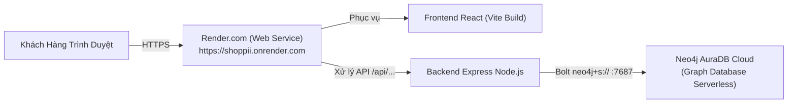

# HƯỚNG DẪN CHI TIẾT DEPLOY DỰ ÁN LÊN RENDER.COM & NEO4J CLOUD (AURADB)

Tài liệu này hướng dẫn bạn từng bước cách đưa toàn bộ hệ thống **Shốp Pii** lên Internet hoàn toàn **MIỄN PHÍ 100%** sử dụng:
1. **Neo4j AuraDB Free**: Cơ sở dữ liệu Graph chạy trên đám mây chính thức của Neo4j (Free vĩnh viễn).
2. **Render.com**: Nền tảng Cloud Hosting để chạy Web Service Fullstack (phục vụ cả Backend API và Giao diện Shốp Pii).

---

## 🌐 1. MÔ HÌNH TRIỂN KHAI TRÊN CLOUD



---

## ☁️ BƯỚC 1: TẠO CƠ SỞ DỮ LIỆU NEO4J MIỄN PHÍ (NEO4J AURADB)

Vì Render không hỗ trợ lưu trữ cơ sở dữ liệu đồ thị Neo4j trên gói Free, chúng ta sử dụng **Neo4j AuraDB Free** chính chủ của hãng Neo4j:

1. Truy cập: [https://neo4j.com/cloud/aura-free/](https://neo4j.com/cloud/aura-free/)
2. Đăng ký tài khoản miễn phí (bằng tài khoản Google hoặc Email, **không cần thẻ tín dụng**).
3. Sau khi đăng nhập, tại mục **Instances**, nhấn nút **"New Instance"**.
4. Chọn gói **Free** (Miễn phí vĩnh viễn):
   - Cho phép lưu trữ tới **200.000 Nodes** và **400.000 Relationships**.
   - Phiên bản: `Neo4j 5`.
5. Đặt tên cơ sở dữ liệu (ví dụ: `ShopeeGraphDB`).
6. **CỰC KỲ QUAN TRỌNG:**
   - Màn hình sẽ hiện ra mật khẩu được tạo ngẫu nhiên (hoặc file `.txt` credentials).
   - Hãy bấm **Download credentials** và lưu lại cẩn thận:
     - **URI kết nối:** `neo4j+s://<mã-db>.databases.neo4j.io`
     - **Username:** `neo4j`
     - **Password:** `<mật-khẩu-của-bạn>`
7. Đợi khoảng 2-3 phút để AuraDB khởi tạo (khi chấm tròn chuyển sang màu xanh lá **Running** là hoàn tất).

---

## 📦 BƯỚC 2: SEED (NẠP) DỮ LIỆU LÊN NEO4J AURADB TỪ MÁY BẠN

Để đám mây AuraDB có sẵn 108 sản phẩm, 50 khách hàng và 450+ quan hệ gợi ý:

1. Mở file `backend/.env` trên máy tính của bạn và tạm thời thay bằng thông tin AuraDB vừa tạo:
   ```env
   PORT=5000
   NEO4J_URI=neo4j+s://xxxx.databases.neo4j.io
   NEO4J_USER=neo4j
   NEO4J_PASSWORD=mật_khẩu_Aura_vừa_tải_về
   NEO4J_DATABASE=neo4j
   ```
2. Mở Terminal tại máy bạn và chạy lệnh:
   ```bash
   cd d:\NoSQL\RecommendationProject\backend
   npm run seed
   ```
3. Sau 5 giây, màn hình hiện thông báo **"🎉 SEED DỮ LIỆU THÀNH CÔNG VÀ HOÀN TẤT!"**.  
   *Lúc này toàn bộ dữ liệu mẫu chuẩn Shopee đã được nạp trực tiếp lên Cloud Neo4j Aura!*

---

## 🐙 BƯỚC 3: ĐƯA DỰ ÁN LÊN GITHUB

Render sẽ tự động kéo code từ GitHub về để build và deploy:

1. Đảm bảo file `.gitignore` đã có `node_modules` và `.env`.
2. Mở Terminal tại thư mục gốc `RecommendationProject`:
   ```bash
   git init
   git add .
   git commit -m "Khoi tao du an Shop Pii Neo4j Recommendation"
   ```
3. Tạo một Repository mới trên GitHub (ví dụ: `ShopPii-Recommendation-Neo4j`).
4. Đẩy mã nguồn lên:
   ```bash
   git remote add origin https://github.com/<tai-khoan-cua-ban>/ShopPii-Recommendation-Neo4j.git
   git branch -M main
   git push -u origin main
   ```

---

## 🚀 BƯỚC 4: TẠO WEB SERVICE TRÊN RENDER.COM

1. Truy cập [https://render.com/](https://render.com/) và đăng nhập (bằng tài khoản GitHub).
2. Tại bảng điều khiển Render Dashboard, nhấn nút **"New +"** $\rightarrow$ chọn **"Web Service"**.
3. Chọn mục **"Build and deploy from a Git repository"** $\rightarrow$ bấm **Next**.
4. Tìm và nhấn **"Connect"** với repository GitHub bạn vừa đẩy lên ở Bước 3.
5. Điền các thông số cấu hình:
   - **Name:** `shoppii-recommendation` (hoặc tên tùy thích, tên này sẽ là subdomain `https://...onrender.com`).
   - **Region:** Chọn **Singapore** (Gần Việt Nam nhất, tốc độ phản hồi nhanh nhất).
   - **Branch:** `main`
   - **Root Directory:** *(Để trống)*
   - **Environment:** `Node`
   - **Plan Type:** Chọn **Free** ($0/tháng).
6. **Build Command (Lệnh build cả Frontend và Backend):**
   ```bash
   cd frontend && npm install && npm run build && cd ../backend && npm install && npm run build
   ```
7. **Start Command (Lệnh khởi chạy Server):**
   ```bash
   cd backend && npm start
   ```

---

## 🔑 BƯỚC 5: CẤU HÌNH BIẾN MÔI TRƯỜNG (ENVIRONMENT VARIABLES) TRÊN RENDER

Cuộn xuống phần **"Environment Variables"**, bấm nút **"Add Environment Variable"** để thêm 5 biến sau:

| Tên biến (Key) | Giá trị (Value) | Ghi chú |
| :--- | :--- | :--- |
| `NODE_ENV` | `production` | Chế độ chạy sản phẩm tối ưu |
| `NEO4J_URI` | `neo4j+s://xxxx.databases.neo4j.io` | Copy từ Neo4j AuraDB ở Bước 1 |
| `NEO4J_USER` | `neo4j` | Mặc định là `neo4j` |
| `NEO4J_PASSWORD` | `<mật khẩu AuraDB của bạn>` | Mật khẩu tải từ Neo4j Aura |
| `NEO4J_DATABASE` | `neo4j` | Tên database mặc định |

*(Lưu ý: Biến `PORT` không cần cấu hình, Render sẽ tự động cấp phát cổng).*

---

## 🎉 BƯỚC 6: TRIỂN KHAI VÀ THỬ NGHIỆM

1. Nhấn nút **"Deploy Web Service"** (màu xanh ở cuối trang).
2. Render sẽ bắt đầu quá trình cài đặt thư viện, build Vite React và khởi động Express Server. Quá trình này mất khoảng 2-3 phút.
3. Khi trong mục Logs xuất hiện dòng:
   ```text
   ==> Uploading build...
   ==> Build successful 🎉
   ==> Deploying...
   ✅ [Neo4j] Connected successfully to database!
   🚀 Server Backend Shốp Pii đang chạy tại: http://localhost:10000
   ==> Your service is live 🚀
   ```
4. Bấm vào đường dẫn URL công khai được Render cấp ở đầu trang (ví dụ: `https://shoppii-recommendation.onrender.com`).
5. **Thành quả:**
   - Trang web **Shốp Pii** chạy trực tiếp trên Internet.
   - Giỏ hàng, Đăng nhập, Đăng ký, Lọc danh mục và Mục Gợi Ý Hồng Nay hoạt động theo thời gian thực kết nối với cơ sở dữ liệu Neo4j AuraDB trên đám mây!

---

## 💡 MẸO SỬ DỤNG CHO BUỔI BẢO VỆ ĐỒ ÁN
- Vì Render gói Free sẽ tự động "ngủ đông" (Spin down) sau 15 phút không có người truy cập:
  - **Trước giờ vào phòng chấm thi khoảng 3 - 5 phút**, hãy mở trước link `https://shoppii-recommendation.onrender.com` trên điện thoại hoặc laptop để server thức dậy sẵn sàng.
  - Mang link này vào slide báo cáo hoặc quét mã QR Code để Thầy Cô trong Hội đồng có thể tự mở trên điện thoại trải nghiệm trực tiếp!
